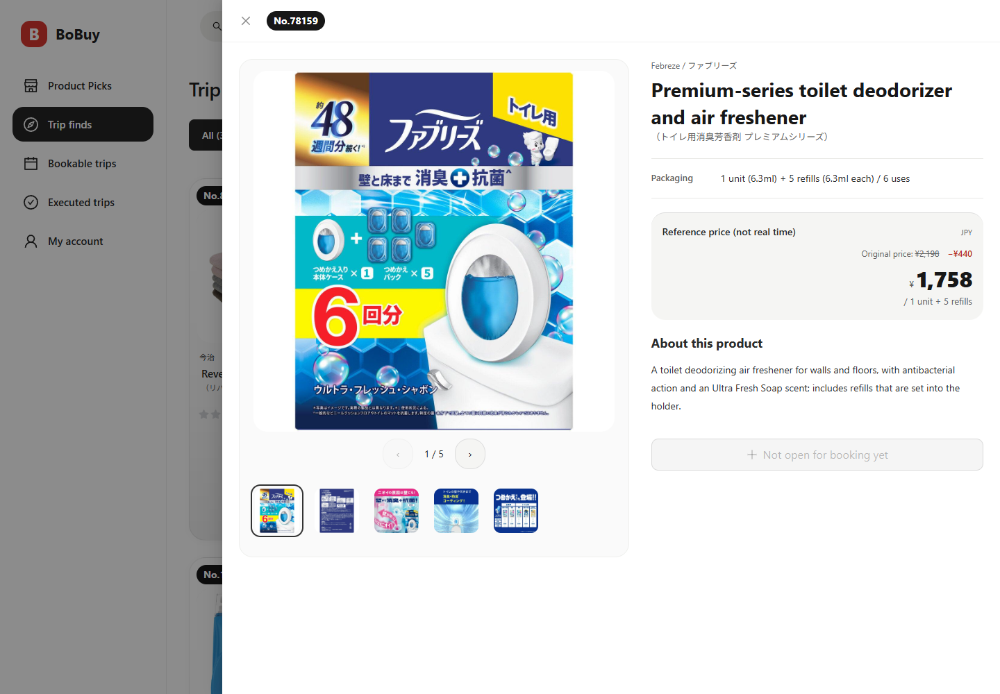
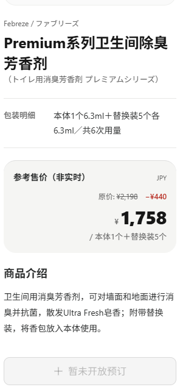

# 商品介绍与规格四语交付

生产版本：`ea7b7fe`，前端镜像`20261112.product-fact-localization`，日本时间2026-11-12 15:09:01上线。后端5a9bb64容器保持一致，schemaV33。仓库交付见[PR70](https://github.com/sunshaoxuan/bobuy/pull/70)。本目录记录应用候选的实际源码和运行镜像，后续证据归档提交保持应用目录一致。

已补存4项官方商品卡对应的四语介绍：97443、93588、92956、92495。389项主档中380项介绍完整，9项身份资料缺口见[清单](unresolved-products.json)与[主任务记录](../../PRODUCT-INTRODUCTIONS-20261112.md)。4项均通过普通商家界面保存及重新读取，其他提交字段保持原值；公开状态保持原样。

245条精确原文的四语资源覆盖327个已知来源值，包括389项主档的型号说明/包装及325项公开商品的历史价格单位。数量、型号、尺寸、包装组合、价格与历史快照保持一致。已有四语规格继续使用已审核文本。

验证包括首轮120文件/818项测试、最终受影响8文件/48项测试、最终构建和实际应用候选三语言CodeQL。浏览器核对卡片、四语商品详情1440/320、四语推荐详情360、最长单位、规格来源提示、图集切换、关闭/重新打开以及日本日期下的过期价格。65项请求无失败，控制台无错误；82项容器文件与16项已成功浏览器响应的字节摘要匹配发布清单。

主要回执：[总体验收](acceptance.json)、[源码绑定](source-binding.json)、[内容验收](content-acceptance.json)、[官方来源](official-sources.json)、[覆盖](coverage.json)、[公开历史保持](public-unchanged.json)、[生产运行](production-current.json)、[浏览器矩阵](production-matrix.json)、[截图清单](production-crop-manifest.json)、[视觉复核](visual-review-resolution.md)。

截图为生产真实商品数据。桌面1440×1000，手机320×1000，推荐入口360×1000。原尺寸局部图只从已核对的完整PNG裁出，像素一致性已验证。手机最终证据包含完整介绍和底部按钮，较早未完成滚动的帧保存在`initial/`并标为失效。

独立Python静态资源请求收到403，未作重试；资源身份改由已有成功浏览器响应的内容摘要确认，没有新增资源请求或凭据变更。视觉模型输出保留独立来源，最终像素验收由主Agent完成。

正式原始资料和官方图片在忽略的`private/`中保留，公开记录只保留必要摘要、自己的四语文案及来源URL/SHA。旧前端镜像与本次`compose.before.yml`保留供应用回滚；已保存介绍兼容，数据恢复不覆盖新写入。临时目录/进程清理见`cleanup.json`。
